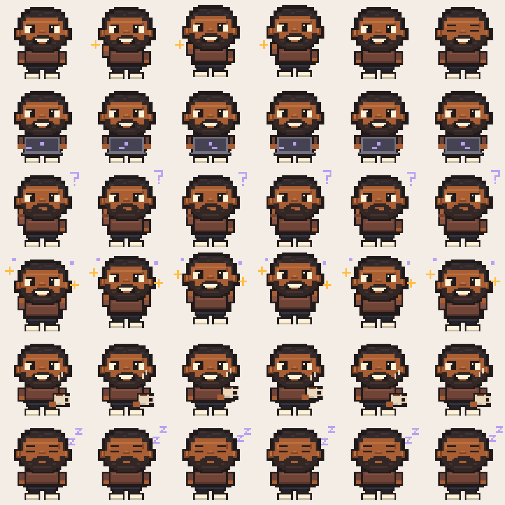

# Tolu Tamagotchi

A small pixel-art companion for any web page. It sits in the lower-right corner, animates in one of six moods and shows two stat bars (Energy and Focus). Click it and it celebrates.



- **No dependencies, no build step.** One classic script, one stylesheet and six PNG sprite sheets.
- **Framework-agnostic.** Works in a plain HTML page or inside any framework through a small adapter.
- **Your page owns the state.** Nothing is measured, fetched, stored or sent anywhere. Stats change only when your code calls the API. The default stats (Energy 80, Focus 92) are illustrative.

## Try it

Open `standalone-demo.html` directly in a browser. It inlines the script, styles and sprites, so it needs no server. Use the controls to try every mood, move both sliders, celebrate, take a coffee break and click the avatar.

To test the real files the way a site would load them, serve the folder and open `demo.html`:

```sh
python3 -m http.server 8000
# then visit http://localhost:8000/demo.html
```

## Installation

This is a copyable browser component, not an npm package. Vendor it into the site that uses it, pinned to a release tag.

As a git submodule:

```sh
git submodule add git@github.com:tiakindele/tolu-tamagotchi.git vendor/tolu-tamagotchi
git -C vendor/tolu-tamagotchi checkout v0.1.0
```

Or copy the files. Only these need to be publicly served:

```text
companion.js
companion.css
sprites/idle.png
sprites/coding.png
sprites/thinking.png
sprites/celebrating.png
sprites/recharging.png
sprites/sleeping.png
```

The demos, docs, preview image, scripts and generator are for development only.

## Quick start

Load the stylesheet and script, then mount once the `<body>` exists (put the script at the end of the body, or mount after `DOMContentLoaded`):

```html
<link rel="stylesheet" href="/tolu-tamagotchi/companion.css">

<!-- ...page content... -->

<script src="/tolu-tamagotchi/companion.js"></script>
<script>
  window.companion = ToluCompanion.mount({
    initialState: { mood: 'idle', energy: 80, focus: 92 },
  });
</script>
```

Adjust the paths to wherever your site serves the files, including any deployment subpath.

If the site's content security policy forbids inline scripts, put the mount call in the page's own JS file and load it after `companion.js`:

```js
const companion = window.ToluCompanion.mount({
  name: 'Tolu',
  assetBase: '/tolu-tamagotchi/sprites/',
  initialState: { mood: 'idle', energy: 80, focus: 92 },
});
window.companion = companion;
```

### In a framework or client-side router

Mount once when the page's view appears and call `destroy()` when it goes away. A classic multi-page site needs no teardown: the browser discards the page on navigation.

If a bundler moves or renames `companion.js`, the script can no longer find its sprites by itself: copy the sprites as static assets and pass `assetBase` (or `sprites`) explicitly.

## Configuration

`ToluCompanion.mount(options)` takes an optional object. Every field is optional.

| Option | Type | Default | What it does |
| --- | --- | --- | --- |
| `target` | `Element` | `document.body` | Element the companion is appended to. |
| `assetBase` | `string` | `sprites/` next to `companion.js` | Folder URL holding `<mood>.png` for every mood. Relative URLs resolve against the page. A missing trailing slash is added. |
| `sprites` | `{ [mood]: string }` | none | Per-mood sprite URLs. Any mood listed here overrides `assetBase`; the rest still come from `assetBase`. |
| `name` | `string` | `'Tolu'` | Name shown in the panel and used in accessible labels. |
| `initialState` | `{ mood?, energy?, focus? }` | `{ mood: 'idle', energy: 80, focus: 92 }` | Starting state. Same rules as `setState`. |

The script finds its own location through `document.currentScript` when it first runs. When that isn't available (a bundled or module build), it falls back to the page URL, so pass `assetBase` in that case. On a page whose own URL can't resolve relative paths (a `data:` URL, for example), pass `assetBase` as an absolute URL, or `mount` throws.

### Custom artwork

Each sprite sheet is a transparent PNG, 288×48, with six 48×48 frames laid out left to right. Any replacement sheet with the same layout works, so the same runtime can show another character: pass `name` plus `assetBase` or `sprites`.

`generate_sprites.py` is the source the current pixel art was drawn from. It is optional and needs Pillow (`pip install pillow`), which is never a runtime dependency. Running it overwrites `sprites/*.png` and `sprite-preview.png`. The artwork is a pixel-grid recreation of an approved mockup, not an exact crop of it.

### Styling

The default layout is fixed to the bottom right, 20px from each edge, with a 144px sprite. Override it with CSS loaded after `companion.css`:

```css
.tolu-companion {
  right: 24px;
  bottom: 24px;
}
```

- **Sprite size:** set `--sprite-size` and `--sheet-width` together on `.tolu-companion`. `--sheet-width` must be six times `--sprite-size`. Multiples of 48px keep the pixels crisp.
- **Inline placement:** pass a `target` element and override `position`, `right` and `bottom` in your stylesheet.
- **Small screens:** at 480px wide or less the sprite drops to 96px and the panel narrows.
- **Reduced motion:** when the visitor prefers reduced motion, the sprite shows its first frame without animating and the stat bars stop transitioning.

CSS hooks: `.tolu-companion` (root `<aside>`), `__sprite` (the clickable button), `__panel`, `__heading`, `__name`, `__mood`, `__stat`, `__track`, `__fill`, `__fill--energy`, `__fill--focus`, `__value`.

## JavaScript API

The script defines one global, `window.ToluCompanion`.

### `ToluCompanion.states`

Frozen array of the six moods: `['idle', 'coding', 'thinking', 'celebrating', 'recharging', 'sleeping']`.

### `ToluCompanion.mount(options?)`

Creates the companion, appends it to `target` and returns an instance. Use one instance per page; calling it twice mounts two companions.

### Instance methods

```js
companion.setState({ mood: 'coding', energy: 75, focus: 96 });
companion.setState({ energy: 40 }); // partial update; values clamp to 0–100
companion.celebrate(2000);          // temporary; returns to the underlying mood
companion.recharge(3000);           // temporary coffee animation
companion.sleep();                  // persistent sleeping state
companion.play('thinking', 1500);   // any mood, temporarily
companion.getState();               // underlying state, not the temporary pose
companion.destroy();                // remove from the page
```

| Method | Returns | Behaviour |
| --- | --- | --- |
| `setState(patch)` | new state | Merges `mood`, `energy` and `focus` into the state. Stats are rounded and clamped to 0–100. Passing a `mood` also cancels any temporary pose; a stats-only patch leaves a running pose alone. |
| `getState()` | `{ mood, energy, focus }` | A copy of the persistent state. A temporary pose is not reported. |
| `play(mood, duration = 2200)` | `undefined` | Shows `mood` for `duration` ms, then returns to the persistent mood. A new `play` replaces the one running. |
| `celebrate(ms = 2200)` | `undefined` | `play('celebrating', ms)`. Clicking the sprite does the same. |
| `recharge(ms = 2200)` | `undefined` | `play('recharging', ms)`: the coffee break. |
| `sleep()` | new state | `setState({ mood: 'sleeping' })`. Persists until another mood is set. |
| `destroy()` | `undefined` | Cancels any pending timer and removes the element. Mount again to bring it back. |

### Errors

| Call | Throws |
| --- | --- |
| A mood not in `ToluCompanion.states` | `RangeError: Unknown mood: <mood>` |
| `energy` or `focus` that isn't a finite number | `TypeError: Stat must be a finite number` |
| `play` with a negative or non-finite duration | `RangeError: Invalid duration` |

Numeric strings such as `'75'` are accepted and converted.

### Moods

| Mood | What it shows | One loop of 6 frames |
| --- | --- | --- |
| `idle` | Gentle bob, a wave and a sparkle, the odd blink | 2.4s |
| `coding` | Typing on a laptop | 0.8s |
| `thinking` | Hand to chin, floating question mark | 1.8s |
| `celebrating` | Jumping with both arms up, stars and confetti | 0.85s |
| `recharging` | Sipping a steaming coffee | 1.8s |
| `sleeping` | Eyes closed, floating Zs | 2.4s |

### Accessibility

The companion is an `<aside>` labelled "Tolu companion". The sprite is a real button, reachable by keyboard, with a label that names the current mood. Mood changes are announced through a polite live region. Each stat bar is a `progressbar` with its current value.

## Browser support

Current evergreen browsers. The runtime uses optional chaining and `Object.hasOwn`, so Safari 15.4 or later.

## Repository layout

| Path | Purpose |
| --- | --- |
| `companion.js`, `companion.css` | The runtime: classic script exposing `window.ToluCompanion`, and its styles. |
| `sprites/` | Six transparent PNG sprite sheets, one per mood. |
| `demo.html` | Demo that loads the real runtime files; serve the folder to use it. |
| `standalone-demo.html` | Self-contained demo with the runtime and sprites inlined; opens straight from disk. |
| `sprite-preview.png` | Every frame of every mood, enlarged. |
| `generate_sprites.py` | Optional source for regenerating the pixel art (needs Pillow). |
| `scripts/build-standalone.py` | Rebuilds `standalone-demo.html` from `demo.html`, the runtime and the sprites (`--check` to verify). |
| `AGENTS.md` | Instructions for coding agents working on this repository. |

No credentials, telemetry or host-specific code are included.
